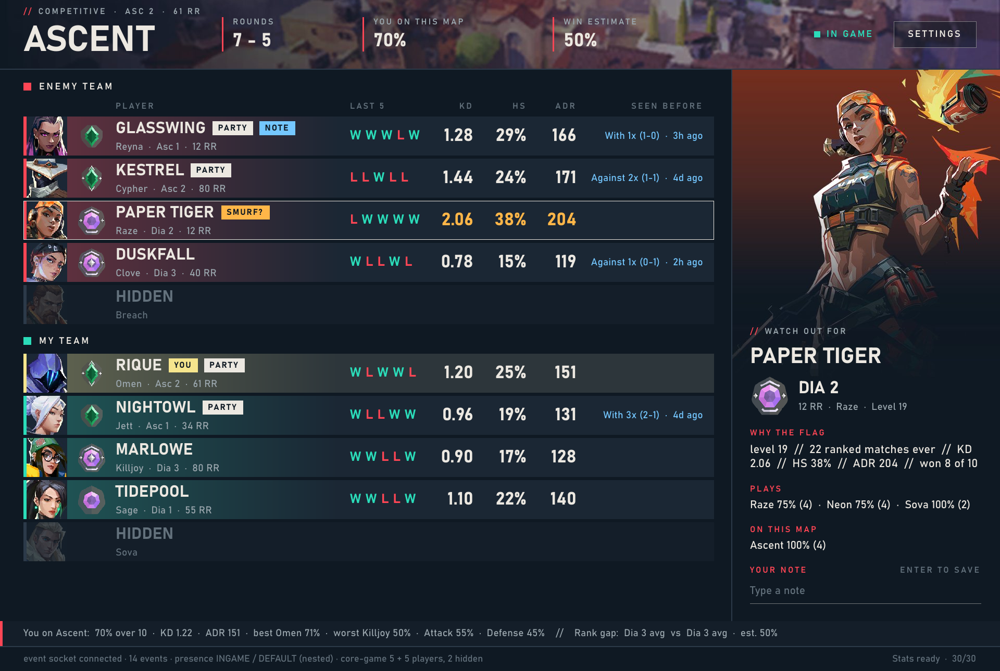
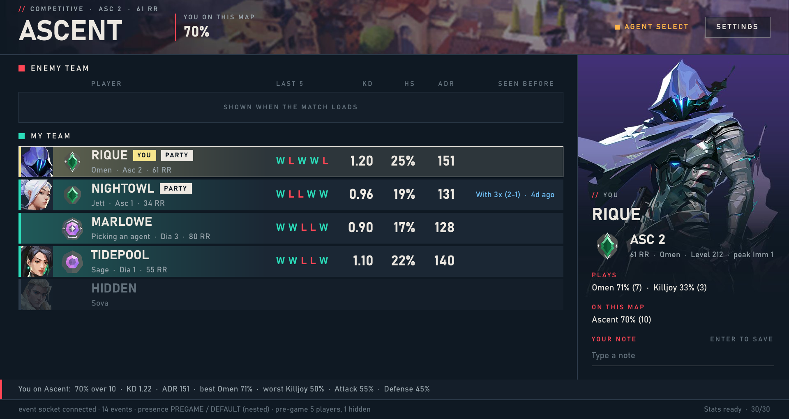
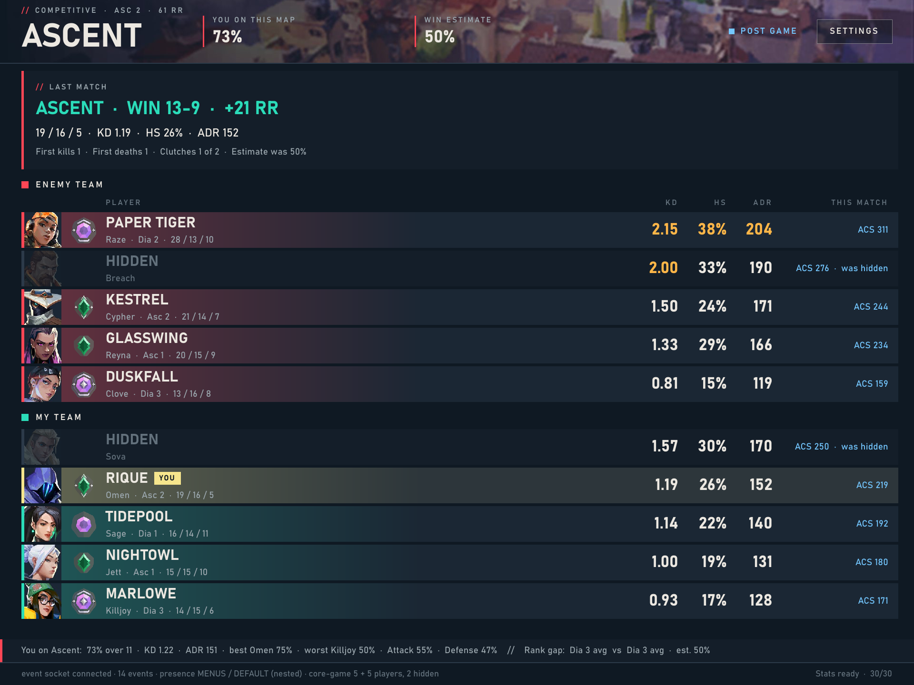
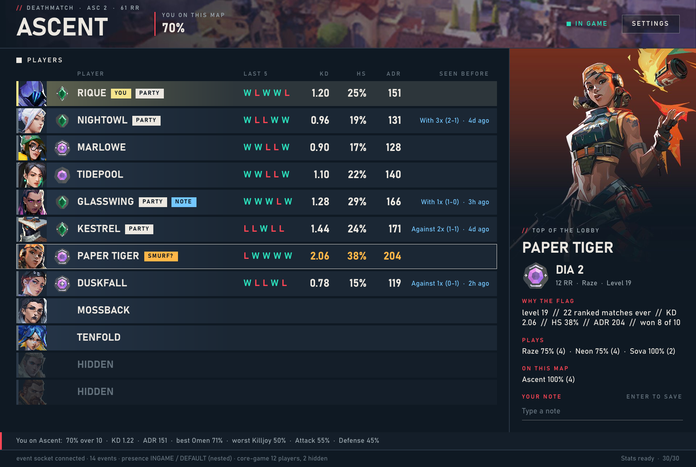
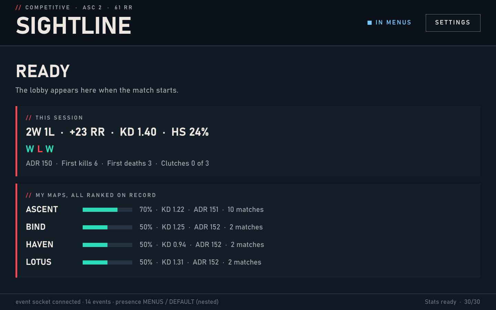
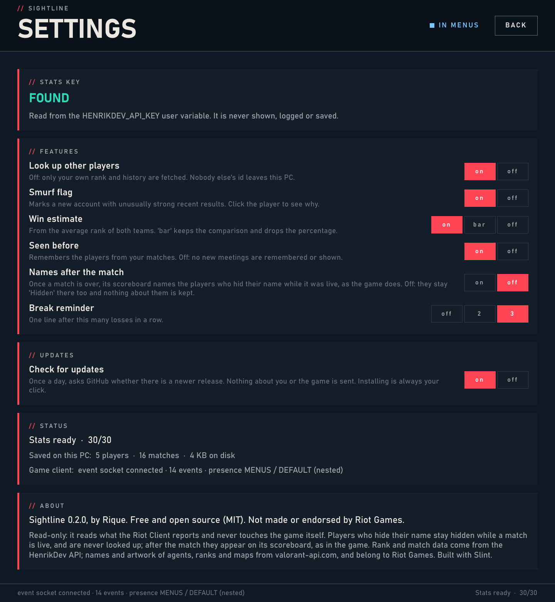
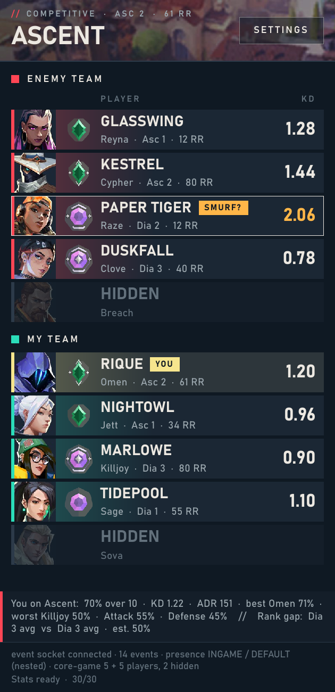

# Sightline

[](https://github.com/Riqqqque/Sightline/actions/workflows/ci.yml)
[](https://github.com/Riqqqque/Sightline/releases/latest)
[](LICENSE)

A live-match companion for VALORANT that sits on your second monitor. It shows who is in your
lobby and match (rank, recent form, whether you have met before) and, once the match is over,
its full scoreboard. It is a separate window, it is read-only, and it stays small.



<sub>Every picture on this page is the real window, drawn from made-up players.</sub>

> **Read this first.** Sightline is a fan project. It is not made, approved or endorsed by Riot
> Games. Riot's developer policy lists tools that show opponents' stats before a match as an
> unapproved use, so you run it at your own risk. See [Is it allowed?](#is-it-allowed).

## What it does

- **Lobby and match list.** Both teams as soon as the game knows them: agent, name, rank badge,
  RR and peak, level, party. In agent select you see your own team; the other team appears when
  the match loads, because that is when the game itself reveals it.
- **Recent form.** The last five ranked results as `W` and `L`, plus KD, headshot rate and ADR
  over the last ten ranked matches.
- **Seen before.** "With 3x (2-1) · 4d ago": players you have already played with or against,
  and how those matches went. You can keep a note on any player.
- **Smurf flag.** A quiet hint for a new account with unusually strong results. It needs both,
  so a good veteran is never flagged. Click the player to see why.
  [How it is scored](docs/smurf-score.md).
- **Rank gap.** Both teams' average rank and a rough win estimate, once enough ranks are known.
- **Your record on the map.** Win rate, KD, ADR, best and worst agent, attack and defense, from
  your whole ranked history.
- **Round score** while the match is on.
- **After the match.** The scoreboard for all ten players (K / D / A, KD, HS, ADR, ACS), your own
  first kills, first deaths and clutches, the RR change, and your session so far. Players who
  hid their name stay "Hidden" there unless you choose otherwise in Settings.
- **Every mode.** Deathmatch is one list; team modes are two.

## A look around

| Agent select | After the match |
| --- | --- |
| [](docs/readme/agent-select.png) | [](docs/readme/post-game.png) |
| Your team as it picks. The other team shows up when the match loads. | All ten players, your own match in numbers, and the RR change. |

| Deathmatch | Between matches |
| --- | --- |
| [](docs/readme/deathmatch.png) | [](docs/readme/session.png) |
| One list, readable players first, hidden ones last. | Your session so far and your record on every map. |

| Settings | A narrow window |
| --- | --- |
| <a href="docs/readme/settings.png"></a> | <a href="docs/readme/narrow.png"></a> |
| Every feature has a switch. | Shrink it to a strip and it keeps the essentials. |

## What it does not do

- It does not read the game's memory, inject anything, hook the renderer or send input. It reads
  what the Riot Client on your PC reports about your own session, and public match data.
- It does not show a player who hides their name while the match is live. No name, no rank, no
  history, no "seen before": the app never even keeps an id for a hidden slot.
- It cannot show per-player kills and deaths during a match. That would need the game's memory
  or the screen, and it will not go there.
- No telemetry, no accounts, no ads.

## Getting started

You need Windows 10 or 11, VALORANT, and a key for the
[HenrikDev API](https://docs.henrikdev.xyz), which is where ranks and match history come from.
A free key is enough.

1. Download `Sightline.exe` from the [latest release](https://github.com/Riqqqque/Sightline/releases/latest)
   and put it anywhere you like. There is no installer.
2. Store your key in a user environment variable named `HENRIKDEV_API_KEY`. In PowerShell:

   ```powershell
   [Environment]::SetEnvironmentVariable('HENRIKDEV_API_KEY', 'your-key-here', 'User')
   ```

3. Start Sightline, then start VALORANT. It wakes up when the game does.

Windows may warn about an unrecognised app the first time: the exe is not code-signed. Each
release lists the file's SHA-256 so you can check what you downloaded.

Without a key the player list, notes and "seen before" still work; ranks and match history are
off, and Settings says so.

## Settings

| Setting | What it does |
| --- | --- |
| Look up other players | Off: only your own rank and history are fetched. Nobody else's id leaves your PC. |
| Smurf flag | The "possible smurf" hint. |
| Win estimate | On, bar only (no percentage), or off. |
| Seen before | Off: no new meetings are remembered or shown. |
| Names after the match | Off by default: players who hid their name stay "Hidden" on the post-game scoreboard too (you still see their numbers), and nothing about them is kept. On: once a match is over they are named there, as on the game's own end screen. |
| Break reminder | One line after two or three losses in a row. |
| Check for updates | Once a day, asks GitHub whether there is a newer release. |

## Updating

When a newer release exists, Settings shows **Update to x.y.z**. One click downloads the new
exe from this repository's releases, checks it against the SHA-256 published with the release,
swaps it in and restarts. Nothing is installed without that click, and a download that does not
match its checksum is thrown away. You can switch the daily check off.

## Privacy: what leaves your PC

| To | What | When |
| --- | --- | --- |
| Riot's servers | Requests for your own lobby and match, made with the session your running game client already holds, and one name lookup for the visible players. | Agent select and match start. |
| HenrikDev | The ids of the visible players in your lobby, and your own, to get rank and match history. | When a lobby loads. "Look up other players" off limits this to you. |
| valorant-api.com | Nothing about you: the list of agent and map names. | Once per run. |
| GitHub | Nothing about you: "what is the newest release?" | Once a day, if update checks are on. |

Everything Sightline remembers (matches, notes, who you met) is one SQLite file on your PC:
`%LOCALAPPDATA%\Sightline\sightline.db`. Your API key is read from the environment variable and
is never shown, logged or written anywhere. Your Riot session tokens are held in memory only.

## Is it allowed?

Honestly: not by Riot's rules. Their developer policy names "seeing an opponent's stats before a
match starts" as an unapproved use, and personal tools cannot be registered. Sightline is built
to ask as little as possible of your game session (a few lobby requests per match, no memory
access, nothing that plays the game for you), and it never touches the game process. None of
that makes it approved. Nobody can promise what Riot will or will not act on, and
the research behind this is written down in [docs/data-sources.md](docs/data-sources.md). Decide
for yourself.

## Performance

It is a single small process: one window drawn by a software renderer, one worker thread, no
background services. It does nothing between game events.

| Window | Memory (private) | CPU when idle |
| --- | --- | --- |
| Maximised on a 4K monitor (3840 x 2054) | 40 to 44 MB | 0% |
| Half of that monitor (1920 px wide) | about 20 MB, measured before the artwork was added | 0% |
| Narrow (720 px wide) | about 10 MB, measured before the artwork was added | 0% |

Memory is almost entirely the window's own pixels, so a smaller window uses less. The artwork
adds about 2 MB to the exe.

## Building from source

You need Rust 1.100 (picked up from `rust-toolchain.toml`) and the Visual Studio C++ build tools.

```powershell
git clone https://github.com/Riqqqque/Sightline
cd Sightline
tools\make-art.ps1 -Download   # optional: fetches the game art (about 38 MB) and shrinks it
cargo test
cargo build --release
```

Without the art step it still builds; agents show as letters and ranks as text. The art belongs
to Riot Games and is not part of this repository.

Useful while working on it:

- `target\release\sightline.exe --fixture match` runs the whole app on made-up players, with no
  game and no network. Other fixtures: `lobby`, `dm`, `dm12`, `post`, `menu`, `tour`, `nokey`.
- `tools\render.ps1 -State match -Out shot.png` draws the window into a picture without opening
  one. The pictures on this page are made that way, with `show:` in front of the state
  (`-State 'show:match'`) for a fuller cast of made-up players.
- `tools\quiet-cargo.ps1 -CargoArgs 'test'` builds at low priority, for when a game is running.

How it is put together: [docs/architecture.md](docs/architecture.md). Why things are the way
they are: [docs/decisions.md](docs/decisions.md).

## Credits

- Rank and match data: the [HenrikDev unofficial VALORANT API](https://github.com/Henrik-3/unofficial-valorant-api).
- Agent, rank and map names and artwork: [valorant-api.com](https://valorant-api.com).
- Which client endpoints exist was learned from
  [VALORANT-rank-yoinker](https://github.com/zayKenyon/VALORANT-rank-yoinker) (ISC). No code is copied.
- The window is built with [Slint](https://slint.dev).

## Licence

[MIT](LICENSE). The game artwork inside the released exe is not covered by it; see [NOTICE](NOTICE).

Sightline isn't endorsed by Riot Games and doesn't reflect the views or opinions of Riot Games
or anyone officially involved in producing or managing Riot Games properties. Riot Games, and
all associated properties are trademarks or registered trademarks of Riot Games, Inc.
